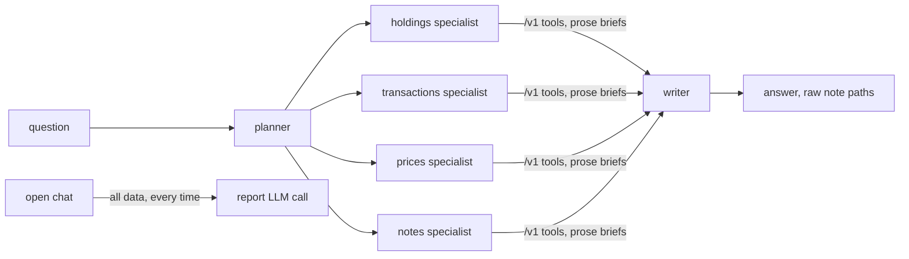
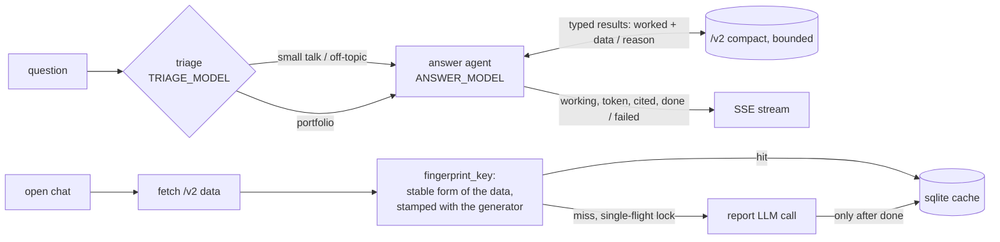

# Architecture

Components: `portfolio_api/` (example data, `/v1` verbose and `/v2` compact), `agent_v1/`,
`agent_v2/`, `server/` (FastAPI, `/ask` and `/briefing`), `client/` (rich CLI), `bench/`.

## Data API

`/v1`: lists of row dicts (field names repeated per row), whole history, rows shuffled on every
request, volatile fields (`retrieved_on`, `trace_id`). `/v2`: `{"header": [...], "table": [[...]]}`,
stable sort, `window_start` / `window_end` (default last 90 days, max 366). Seeded gaps: one client
holds an instrument with no prices; the transactions endpoint of one client fails at `FAIL_RATE`.

## Agent v1

## Agent v2

## Fingerprint

`stable_form()` sorts keys and rows, rounds floats, and drops `VOLATILE_KEYS`
(`retrieved_on`, `trace_id`). `fingerprint_key()` is a blake2b fingerprint of that stable form,
stamped with what generated the report. `scripts/fingerprint_stability.py` shows 25 raw payload
hashes collapsing to 1.
